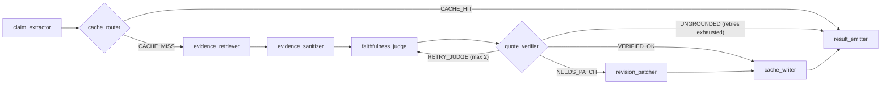
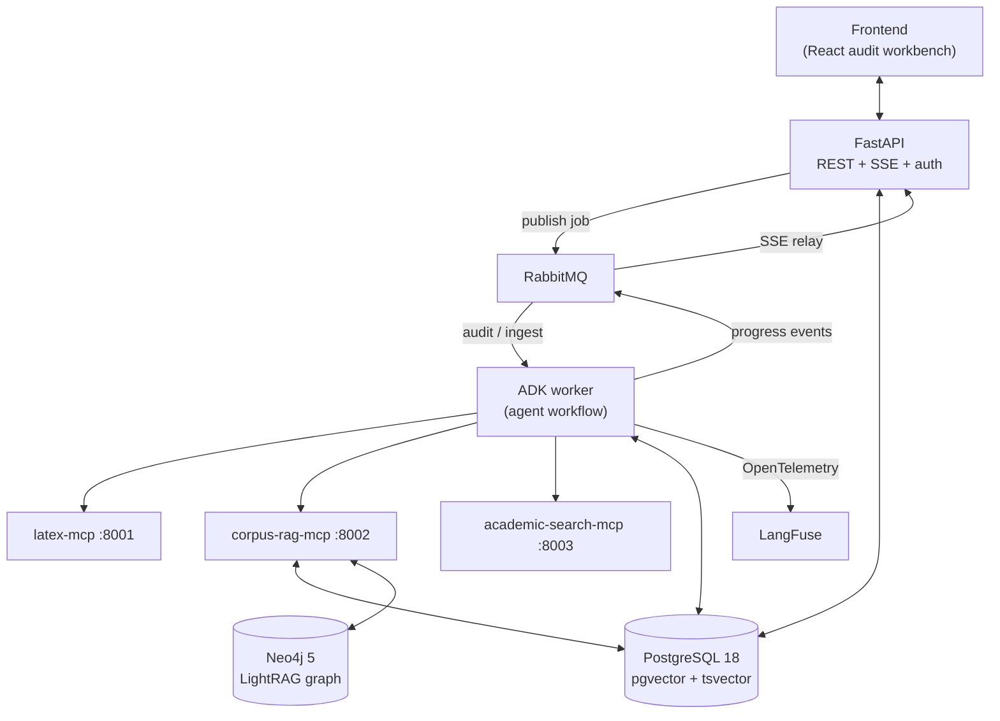

# CiteGuard

**Autonomous citation and claim faithfulness auditor for Master's thesis drafts.**

CiteGuard reads a thesis chapter (`.tex` or `.md`), extracts every cited claim, and checks each one against the paper it cites. It reports claims the source does not support, numbers that drifted from the original, and citations that point at the wrong paper, then proposes a fix as a reviewable patch.

> **Status: design phase.** This repository currently contains the Technical Design Document only. Nothing described below is implemented yet. See [docs/TDD.md](docs/TDD.md) for the full design and [Roadmap](#roadmap) for the build plan.

## Contents

- [What it checks](#what-it-checks)
- [How it works](#how-it-works)
- [Architecture](#architecture)
- [Agents](#agents)
- [MCP tool servers](#mcp-tool-servers)
- [Memory](#memory)
- [Security model](#security-model)
- [Observability](#observability)
- [Tech stack](#tech-stack)
- [Planned repository layout](#planned-repository-layout)
- [Running it](#running-it)
- [Evaluation](#evaluation)
- [Roadmap](#roadmap)
- [Versioning](#versioning)
- [License](#license)

## What it checks

| Problem | Example |
| :--- | :--- |
| Unsupported claim | The thesis says a paper shows something the paper never states. |
| Numeric drift | The thesis reports 94.2%, the paper's table says 91.8%. |
| Citation-key swap | The claim is real, but it comes from a different paper in the bibliography. |
| Secondary citation drift | Paper B is cited for a result that originated in Paper A and was distorted on the way. |
| Cross-paper contradiction | Two cited papers report conflicting numbers on the same benchmark, or a newer paper refutes the cited one. |

Each claim receives one of four verdicts: `SUPPORTED`, `PARTIALLY_SUPPORTED`, `CONTRADICTED` or `NOT_FOUND`. Every verdict except `NOT_FOUND` must carry a verbatim quote from the source with its page number.

**What CiteGuard does not do:**

- It never edits your thesis repository. Fixes are emitted as unified `.patch` diffs for you to review and apply.
- It does not compile LaTeX to PDF.

## How it works

1. You create a project and upload your reference PDFs and `.bib` file. An ingestion worker parses each PDF, indexes its chunks for lexical and vector search, and writes papers, methods, datasets and reported metrics into a knowledge graph.
2. You submit a chapter for audit. The API queues the job and returns immediately.
3. A worker extracts the cited claims, then runs each claim through the pipeline below.
4. Verdicts stream to the browser as they complete. Claims that were already verified against an unchanged source are answered from cache without calling a model.
5. For claims that fail, CiteGuard generates a minimal diff and suggests alternative citations. You accept or dismiss each one, and can tell CiteGuard to remember an exception.

Per-claim pipeline:



## Architecture

Web requests are decoupled from long-running audits by a message broker. The API serves REST and a Server-Sent Events stream; workers consume jobs, run the agent graph, and call tool servers.



Messaging topology:

| Exchange | Routing key | Purpose |
| :--- | :--- | :--- |
| `citeguard.commands` (direct) | `audit.chapter.requested` | Audit jobs, consumed with manual ack. |
| `citeguard.commands` (direct) | `ingest.paper.requested` | PDF ingestion jobs. |
| `citeguard.events` (topic) | `audit.{run_id}.progress` | Per-claim progress relayed to the browser over SSE. |
| `citeguard.dlx` (direct) | `dlq` | Messages that failed 3 retries. The audit run is marked `FAILED`. |

## Agents

The pipeline is a Google ADK 2.x `Workflow` that mixes four LLM agents with deterministic function nodes. Each agent can only call the tools listed for it.

| Component | Kind | Model | Tools | Role |
| :--- | :--- | :--- | :--- | :--- |
| `claim_extractor` | LLM agent | `gemini-2.5-flash` | `parse_latex_section`, `resolve_bibtex_key` | Turns a chapter into a structured batch of cited claims. |
| `cache_router` | Function | none | database lookup | Fingerprints the claim and routes to cache hit or miss. |
| `evidence_retriever` | LLM agent | `gemini-2.5-flash` | `search_paper_chunks`, `query_lightrag_graph`, `get_page_window`, `get_paper_index_status`, `lookup_paper_by_identifier` | Finds the exact passages and any graph lineage or contradictions. |
| `evidence_sanitizer` | Function | none | none | Strips hidden text and injection attempts, wraps evidence in `<untrusted_evidence>` tags. |
| `faithfulness_judge` | LLM agent | `gemini-2.5-pro` | `record_audit_verdict` only | Decides entailment and emits a schema-constrained verdict. |
| `quote_verifier` | Function | none | none | Confirms the quoted evidence exists verbatim in the retrieved text. |
| `revision_patcher` | LLM agent | `gemini-2.5-pro` | `generate_latex_diff`, `search_candidate_citations` | Writes a minimal diff and proposes better citations. |

The judge's output is constrained to a Pydantic schema (`ClaimVerificationVerdict`) rather than prompt-instructed JSON. The schema rejects any verdict other than `NOT_FOUND` that lacks a source quote and an evidence reference. Full schema: [TDD §3.3](docs/TDD.md).

## MCP tool servers

External capabilities live in three standalone [FastMCP](https://github.com/jlowin/fastmcp) services, reached over Streamable HTTP and authenticated with internal service tokens.

**`latex-mcp`** (port 8001) reads thesis files from a read-only mount.

- `parse_latex_section` returns claim segments with line numbers and citation keys.
- `resolve_bibtex_key` resolves a key to title, authors, year, DOI, arXiv ID and local PDF checksum.
- `generate_latex_diff` returns a unified diff without writing to disk.

**`corpus-rag-mcp`** (port 8002) searches the indexed papers.

- `search_paper_chunks` fuses BM25 and dense embeddings with Reciprocal Rank Fusion. Lexical matching matters here because claims often hinge on exact metrics and p-values.
- `query_lightrag_graph` queries LightRAG over Neo4j for multi-hop lineage and contradictions.
- `get_page_window` fetches neighbouring pages when a claim spans a table or page break.
- `get_paper_index_status` reports whether a paper is indexed, processing or missing.

**`academic-search-mcp`** (port 8003) wraps OpenAlex, Semantic Scholar and arXiv with rate limiting and caching.

- `lookup_paper_by_identifier` fetches abstract and metadata when a local PDF is missing.
- `search_candidate_citations` proposes stronger or primary sources. Only `revision_patcher` may call it.

### Knowledge graph

Alongside LightRAG's automatically extracted entities, ingestion writes typed nodes into Neo4j: `Paper`, `Method`, `Dataset`, `MetricResult`, `Chunk` and `ThesisClaim`, linked by relations such as `CITES`, `REPORTED_METRIC`, `ON_DATASET`, `CONTRADICTS` and `SUPERSEDES`. This is what lets CiteGuard trace a number back to its primary source and spot conflicting results across the bibliography. Schema diagram: [TDD §5.2](docs/TDD.md).

## Memory

**Short-term** state lives in ADK's `DatabaseSessionService` on PostgreSQL. Retrieved chunks are held in temporary turn state and cleared once the quote is verified. Interactive discussion in the patch panel keeps the last 6 turns verbatim plus a rolling summary.

**Long-term** state is served by a custom `CiteGuardMemoryService`:

- `verified_claim_cache` stores verdicts keyed by `sha256(normalized claim, cite key, document hash)`. Re-auditing an edited chapter only pays for the claims that changed.
- `author_memories` stores advisor rules, style preferences and false-positive suppressions as embeddings.
- The Neo4j graph persists paper and claim lineage across chapters.

## Security model

Reference PDFs and external abstracts are treated as untrusted input, since a paper can contain hidden text aimed at the model.

1. **Sanitization.** Zero-width characters and hidden PDF text layers are removed, instruction-like strings are flagged, and evidence is wrapped in explicit data delimiters.
2. **Tool isolation.** The judge has no file, retrieval or web tools, so an injected instruction has nothing to hijack.
3. **Deterministic grounding.** A quote the judge cites must be found verbatim in the retrieved text by plain code, not by another model.
4. **Container hardening.** Services run as non-root, thesis files are mounted read-only, and MCP servers are reachable only on the internal Docker network.

**Authentication** is selected by `AUTH_MODE`:

| | `dev` | `prod` |
| :--- | :--- | :--- |
| Login | Email and password (Argon2id) | Google OAuth 2.0 with PKCE |
| Routes mounted | `/auth/dev/*` | `/auth/google/*` |
| Safety gate | App refuses to start if `ENVIRONMENT=production` | Requires Google client credentials and a 256-bit JWT secret |

Both modes issue the same internal JWT in `HttpOnly` cookies. Every project-scoped route checks that the caller owns the project.

## Observability

API requests, queue handoffs, agent steps and tool calls share one OpenTelemetry trace per audit, exported to LangFuse. Trace context crosses RabbitMQ in the message properties. Spans record token counts, cache hits, retrieval scores and judge retry counts. Evaluation runs attach scores such as `verdict_exact_match` and `quote_groundedness`.

## Tech stack

| Layer | Technology |
| :--- | :--- |
| Agents | Google ADK 2.x, Gemini 2.5 Flash and Pro |
| Tools | FastMCP over Streamable HTTP |
| API | FastAPI, Pydantic v2, Server-Sent Events |
| Messaging | RabbitMQ (`aio-pika` or FastStream) |
| Relational and vector store | PostgreSQL 18 with `pgvector` (HNSW), `tsvector` (GIN), native `uuidv7()` |
| ORM and migrations | SQLAlchemy 2.0 async, Alembic |
| Knowledge graph | Neo4j 5, LightRAG |
| PDF parsing | Docling, PyMuPDF |
| Frontend | Vite 6, React 19, TypeScript, Tailwind CSS v4, shadcn/ui, CodeMirror, TanStack Query |
| Observability | OpenTelemetry, OpenInference, LangFuse v3 (with ClickHouse, Redis, MinIO) |
| Packaging | Docker Compose, `uv`, `pnpm` |

## Planned repository layout

```text
citeguard/
├── backend/                  # FastAPI API, ADK worker, Alembic migrations
│   └── app/
│       ├── api/              # REST, SSE, auth strategies
│       ├── agents/           # Workflow, agents, function nodes, memory service
│       ├── db/               # SQLAlchemy models
│       └── workers/          # RabbitMQ consumers (audit, ingestion)
├── mcp-servers/
│   ├── latex-mcp/
│   ├── corpus-rag-mcp/
│   └── academic-search-mcp/
├── frontend/                 # React audit workbench
├── benchmarks/               # Corruption generator and ablation runner
├── docs/TDD.md               # Technical Design Document
└── docker-compose.yml
```

Only `docs/TDD.md` exists today.

## Running it

There is nothing to run yet. The intended workflow, once the Week 1 milestone lands, is a single Docker Compose stack:

```bash
cp .env.example .env        # set GOOGLE_API_KEY at minimum
docker compose up --build
```

Planned local endpoints:

| Service | URL |
| :--- | :--- |
| Frontend | http://localhost:5173 |
| API | http://localhost:8000 |
| LangFuse | http://localhost:3001 |
| RabbitMQ management | http://localhost:15672 |
| Neo4j browser | http://localhost:7474 |

Planned environment variables:

| Variable | Needed for |
| :--- | :--- |
| `GOOGLE_API_KEY` | Gemini models and embeddings (required) |
| `AUTH_MODE`, `ENVIRONMENT` | Selecting dev or prod authentication |
| `JWT_SECRET_KEY` | Signing session tokens |
| `GOOGLE_CLIENT_ID`, `GOOGLE_CLIENT_SECRET`, `GOOGLE_REDIRECT_URI` | Google login in `prod` mode |
| `POSTGRES_PASSWORD`, `NEO4J_PASSWORD`, `RABBITMQ_USER`, `RABBITMQ_PASS` | Data services |
| `LATEX_MCP_TOKEN`, `CORPUS_MCP_TOKEN`, `ACADEMIC_MCP_TOKEN` | Service-to-service auth |
| `LANGFUSE_PUBLIC_KEY`, `LANGFUSE_SECRET_KEY` | Trace export |
| `LANGFUSE_ENCRYPTION_KEY`, `CLICKHOUSE_PASSWORD`, `REDIS_PASSWORD`, `MINIO_ROOT_PASSWORD`, `LIGHTRAG_DB_PASSWORD` | Self-hosted LangFuse v3 stack and the LightRAG database role |
| `SEMANTIC_SCHOLAR_API_KEY`, `OPENALEX_MAILTO` | External scholarly APIs (optional) |

The compose file in the TDD ships development defaults for most of these. Replace every one of them before any non-local deployment.

## Evaluation

The benchmark is a 180-claim suite built from open-access arXiv papers: 90 unmodified claims and 90 controlled corruptions across four failure modes (numeric drift, scope or polarity inversion, citation-key swap, fabricated metrics). Each ablation compares a control against the full system.

| Axis | Control | Full system | Metrics |
| :--- | :--- | :--- | :--- |
| Orchestration | One agent with all tools | 4-agent workflow with quote verifier | Macro-F1, quote groundedness, cost per 100 claims |
| Constrained decoding | Prompt-instructed JSON | Pydantic output schema | Schema pass@1, parse retries |
| Retrieval | Dense vectors only | BM25 + dense RRF + graph | Recall@5 on numeric drift, contradiction detection rate |
| Memory | Session only | Session + claim cache | p50/p95 latency, prompt token reduction |
| Security | Unsanitized chunks | Sanitizer + zero-tool judge | Attack success rate on 20 injected PDFs |

No results exist yet. They will be published here once the benchmark has been run. How the benchmark is built, labelled and scored is defined in [docs/EVALUATION.md](docs/EVALUATION.md).

## Roadmap

| Week | Milestone |
| :--- | :--- |
| 1 | Compose stack, migrations, dev and prod auth, `latex-mcp`, `academic-search-mcp` |
| 2 | PDF ingestion, `corpus-rag-mcp`, agent workflow, constrained schemas, quote verifier loop |
| 3 | Audit workbench frontend, live progress stream, graph viewer, diff reviewer, tracing |
| 4 | Benchmark and ablations, injection test suite, Google OAuth verification, final report |

The task-level breakdown, with dependencies and exit criteria, is in [docs/IMPLEMENTATION_PLAN.md](docs/IMPLEMENTATION_PLAN.md).

## Versioning

CiteGuard follows [Semantic Versioning](https://semver.org/). The current version is in [`VERSION`](VERSION), release notes are in [CHANGELOG.md](CHANGELOG.md), and the rules for bumping and releasing are in [docs/VERSIONING.md](docs/VERSIONING.md).

## License

[MIT](LICENSE), copyright 2026 FHTW-AI25.
