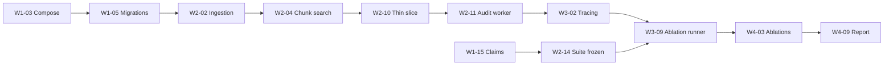

# Implementation Plan

This plan turns the four-week outline in [TDD §12](TDD.md) into ordered tasks. The TDD says *what* to build; this document says *in which order*, *what each task depends on* and *when it counts as done*.

- Design questions are answered by the [TDD](TDD.md). If a task here contradicts it, the TDD wins and this plan gets fixed.
- Task status is not tracked in this file. Create one GitHub issue per task ID, with one milestone per week.
- Section references such as §4.1 point into the TDD.

## Assumptions

These were not specified, so the plan is written around them. Adjust the plan if they are wrong.

| Assumption | Effect if wrong |
| :--- | :--- |
| Four consecutive weeks, no fixed calendar dates yet. | None; weeks are relative. |
| The group has four people, each owning one track full-time for the four weeks. | If someone is unavailable for a week, their critical-path tasks are reassigned first and the [cut order](#cut-order) is applied to the rest. |
| LangFuse is self-hosted as in §11.3. | Using LangFuse Cloud removes task W1-04 almost entirely. |
| A Gemini API key with enough quota for about 180 claims × 10 benchmark runs is available. | Reduce the ablation runs in week 4 (see W4-03). |

## Tracks

The group has four people, so there are four tracks with one owner each. The **Owner** column in the task tables uses the track letter. Put the names in the table below once they are agreed (decision P-05).

| Track | Owner | Scope |
| :--- | :--- | :--- |
| **A — Platform** | _name_ | Compose stack, migrations, FastAPI, auth, RabbitMQ, PDF parsing and chunking, tracing, releases. |
| **B — Retrieval and tools** | _name_ | The three MCP servers, the knowledge graph (LightRAG and Neo4j), hybrid search, the patch agent, the injection suite. |
| **C — Agents** | _name_ | Shared schemas, the ADK workflow, agents and function nodes, both memory types, the ablation runner and benchmark runs. |
| **D — Frontend** | _name_ | The React workbench, CI, and the benchmark dataset in weeks 1 and 2. |

Evaluation is not a separate track. Its tasks are spread across the owners according to who knows the component: D builds the dataset while the frontend has little to integrate with, C writes the runner because C built the ablation switches, and B owns the injection suite because B owns what reads the PDFs.

**Claim labelling is shared by all four.** Each person labels about 23 of the 90 ground-truth claims by the end of week 2 (W1-15, W2-14). D fixes the format, assigns the papers and checks consistency.

Tasks per owner per week, counting shared tasks for each owner:

| Week | A | B | C | D |
| :--- | :--- | :--- | :--- | :--- |
| 1 | 6 | 3 | 3 | 3 |
| 2 | 5 | 4 | 5 | 2 |
| 3 | 3 | 2 | 3 | 4 |
| 4 | 5 | 4 | 4 | 3 |

Counts hide task size, so read them with these notes:

- A is busiest in week 1, but most of those tasks are small and sequential. C helps by taking the LangFuse stack and the models (W1-04, W1-06).
- D has the fewest tasks in week 2 because W2-14 (corruption generator and the frozen 180-claim suite) is the largest single task of the week.
- B has spare capacity in week 3 and is the first person to pull in when a critical-path task slips.

Each pull request is reviewed by one other person. Default pairs: A with C (they meet at the audit worker) and B with D (they meet at the graph and corpus views).

## Working principles

1. **Thin end-to-end slice first.** In week 2, get one claim through the whole pipeline from the command line (W2-10) before perfecting any single component. Integration problems between ADK, MCP and LightRAG are the main schedule risk, so find them early.
2. **Contracts before implementations.** Pydantic schemas, MCP tool signatures and progress event shapes are written in week 1 and early week 2 (W1-07, W2-06). Tracks then build against those contracts with fakes instead of waiting for each other.
3. **The benchmark starts in week 1.** Selecting papers and labelling claims is slow manual work. If it starts in week 4 there will be no results to report.
4. **Ablation switches are built with the feature.** Each component that an ablation turns off (§12) gets its switch when it is written, not retrofitted in week 4.
5. **Every task ships with tests** and a changelog line where a user or deployer would notice the change ([VERSIONING.md](VERSIONING.md)).

## Milestones

Each milestone ends with a tagged release. Breaking changes bump the minor version before 1.0.0.

| Milestone | End of | Release | Exit criterion |
| :--- | :--- | :--- | :--- |
| **M1 — Foundation** | Week 1 | `v0.2.0` | `docker compose up` gives a healthy stack; a user can log in and create a project; two MCP servers answer tool calls. |
| **M2 — Pipeline** | Week 2 | `v0.3.0` | A chapter audited from the command line produces grounded verdicts and patches, with a warm re-run served from cache. |
| **M3 — Product** | Week 3 | `v0.4.0` | The same audit runs from the browser with live progress, patch review and one trace per audit in LangFuse. |
| **M4 — Evidence** | Week 4 | `v1.0.0` | All five ablations have been run and the results are published in the README and the report. |

## Before week 1

Decisions and access that block the first tasks. The three design decisions have proposed records in [`docs/adr/`](adr/README.md), each with a recommendation and the checks to run before accepting it.

| ID | Item |
| :--- | :--- |
| P-01 | Choose the two model tiers and pin exact model versions. [ADR 0001](adr/0001-llm-model-selection.md) |
| P-02 | Decide LangFuse self-hosted (five containers) or LangFuse Cloud. [ADR 0002](adr/0002-langfuse-deployment.md) |
| P-03 | Decide the PDF parsing libraries, given that PyMuPDF is AGPL. [ADR 0003](adr/0003-pdf-parsing-libraries.md) |
| P-04 | Obtain the Gemini API key; create the Google OAuth client for `AUTH_MODE=prod`; optionally request a Semantic Scholar key. |
| P-05 | Agree which person owns each of the four tracks and fill in the names in [Tracks](#tracks). |
| P-06 | Pick the sample thesis chapter and its bibliography used for development and demos (10 to 15 open-access papers). |

## Week 1 — Foundation and data plane

Goal: a running stack with no intelligence in it yet.

| ID | Task | Owner | Depends on | Done when |
| :--- | :--- | :--- | :--- | :--- |
| W1-01 | Repository scaffold: `backend/` and each MCP server as `uv` projects, `frontend/` with `pnpm`, `ruff`, `pytest`, `vitest`, `.env.example`. Replace the planned commands in `CONTRIBUTING.md` with the verified ones. Wire package versions to `VERSION`. | A | — | `uv run pytest` and `pnpm test` run (with zero tests) in a clean clone; commands are recorded in `README.md` and `CLAUDE.md`. |
| W1-02 | CI: lint, type-check and tests on every pull request; check that `CHANGELOG.md` changed. | D | W1-01 | A failing test blocks merge. |
| W1-03 | Compose core: PostgreSQL 18 with `pgvector`, Neo4j, RabbitMQ, with health checks, the `internal` and `edge` networks and the init script for the `langfuse` database. | A | W1-01 | `docker compose up postgres neo4j rabbitmq` reports all healthy. |
| W1-04 | LangFuse v4 stack (ClickHouse, Redis, MinIO, web, worker), checked against LangFuse's official compose file, with SDK and server versions pinned together ([ADR 0002](adr/0002-langfuse-deployment.md)). | C | W1-03 | The LangFuse UI opens; a test span sent with the Python SDK appears in it. |
| W1-05 | Alembic: async environment, bootstrap migration (extension, `adk_sessions` and `lightrag` schemas, LightRAG role, `uuidv7()` check), then all tables and indexes from §6. | A | W1-03 | `alembic upgrade head` and `downgrade base` both succeed on an empty database; autogenerate reports no drift. |
| W1-06 | SQLAlchemy models with `UUIDv7TimestampMixin` and a repository layer. | C | W1-05 | Round-trip tests for each model pass against a real PostgreSQL. |
| W1-07 | Shared contracts package: `ClaimVerificationVerdict`, `ExtractedClaimBatch`, MCP return types (`RawSegment`, `BibEntry`, `ChunkHit`, …), progress events. | C | W1-01 | Schemas import from backend and MCP servers; validator tests cover the grounding rule. |
| W1-08 | FastAPI skeleton: settings, health endpoint, error model, CORS, the fail-closed `AUTH_MODE` startup check. | A | W1-01 | The app refuses to start with `AUTH_MODE=dev` and `ENVIRONMENT=production`. |
| W1-09 | Auth: strategy interface, dev email and password with Argon2id, JWT cookies, refresh and logout, seeded demo user. The Google strategy is implemented but verified in week 4. | A | W1-06, W1-08 | Login, refresh and logout tests pass; dev routes are absent when `AUTH_MODE=prod`. |
| W1-10 | Projects API with `require_project_owner`. | A | W1-09 | A second user gets `404` or `403` on another user's project. |
| W1-11 | MCP server template: FastMCP over Streamable HTTP, bearer-token middleware, non-root Dockerfile, health check. | B | W1-01 | An unauthenticated call is rejected; an authenticated `tools/list` succeeds. |
| W1-12 | `latex-mcp`: `parse_latex_section`, `resolve_bibtex_key`, `generate_latex_diff`, with path containment. | B | W1-07, W1-11 | Golden-file tests on the sample chapter (line numbers, `\cite` variants); path traversal attempts are rejected; the diff applies cleanly with `git apply`. |
| W1-13 | `academic-search-mcp`: `lookup_paper_by_identifier`, `search_candidate_citations`, rate limiting, response cache, identifier validation. | B | W1-07, W1-11 | Tests pass against recorded API responses; a free-text "identifier" is rejected. |
| W1-14 | Frontend scaffold: Vite, Tailwind, shadcn/ui, design tokens from §9.2, routing, API client, login page, project list. | D | W1-01 | A user logs in and creates a project in the browser against the real API. |
| W1-15 | Benchmark corpus: select the open-access papers, download PDFs, start extracting the 90 ground-truth claims with page references, following [`EVALUATION.md`](EVALUATION.md). | D | P-06 | At least 30 claims are labelled; the labelling format is fixed. |

**M1 check:** fresh clone → `cp .env.example .env` → `docker compose up --build` → log in → create a project → call `parse_latex_section` on the sample chapter.

## Week 2 — Knowledge layer and agent pipeline

Goal: a correct audit from the command line. No frontend work depends on this week finishing, because track D builds against the contracts from W1-07 with recorded data.

| ID | Task | Owner | Depends on | Done when |
| :--- | :--- | :--- | :--- | :--- |
| W2-01 | Paper upload endpoint, `paper_storage`, publish `ingest.paper.requested`. RabbitMQ topology declared in code (quorum queues, delivery limit, dead-letter exchange). | A | W1-10 | Uploading a PDF creates a `papers` row and a queued message; a poisoned message lands in the dead-letter queue after 3 deliveries. |
| W2-02 | Ingest worker, part 1: PDF parsing with hidden-text removal, chunking with page numbers, embeddings, `tsvector`. | A | W2-01 | The sample bibliography is indexed; each chunk has a page number; a PDF with zero-size hidden text yields none of that text. |
| W2-03 | Ingest worker, part 2: LightRAG insert per project workspace and the typed Neo4j nodes from §5.2. | B | W2-02 | Cypher queries return `Paper`, `MetricResult` and `CITES` data for the sample corpus; two projects do not see each other's graph. |
| W2-04 | `corpus-rag-mcp`: `search_paper_chunks` (BM25 + dense with RRF, and a dense-only switch), `get_page_window`, `get_paper_index_status`. | B | W2-02 | A retrieval test set of exact-number queries reaches the agreed Recall@5; results are scoped by project. |
| W2-05 | `corpus-rag-mcp`: `query_lightrag_graph` with a switch to disable it. | B | W2-03 | A seeded cross-paper contradiction is returned in `hybrid` mode. |
| W2-06 | Deterministic nodes: `cache_router` (fingerprint), `evidence_sanitizer`, `quote_verifier` (normalisation, retry counter, `UNGROUNDED`), `cache_writer`, `result_emitter`. Each has an ablation switch where §12 needs one. | C | W1-07 | Unit tests cover every route in §3.1, including retry exhaustion; the sanitizer strips the seeded injection strings. |
| W2-07 | `claim_extractor` agent with its `tool_filter`. | C | W1-12 | Extraction on the sample chapter matches a hand-labelled claim list within the agreed tolerance. |
| W2-08 | `evidence_retriever` and `faithfulness_judge` agents: tool filters, constrained output schema, `record_audit_verdict`. | C | W2-04, W2-06 | The judge agent's tool list contains no MCP tool (asserted in a test); verdicts validate on first parse for the sample claims. |
| W2-09 | `revision_patcher` agent. | B | W1-12, W1-13 | Patches for seeded numeric errors apply cleanly and change only the cited lines. |
| W2-10 | **Thin slice:** assemble the `Workflow` and run one claim end to end from a script. Start this as soon as W2-04 returns any result, with stubs for unfinished nodes. | C | W2-06, W2-08 | One command prints a grounded verdict for one claim. |
| W2-11 | Audit worker: consume `audit.chapter.requested`, run extraction, fan out per claim with bounded concurrency, persist `claim_audits` and patches, publish progress events, update `audit_runs`. | A, C | W2-10 | A full chapter audit completes; a crash mid-run leaves the run `FAILED`, not `RUNNING`. |
| W2-12 | Audits API: create audit (`202`), report endpoint. | A | W2-11 | The report for a finished run contains every claim, its quote and page, and its patch. |
| W2-13 | Cache behaviour: warm re-run, invalidation when a claim or a document hash changes. | A | W2-11 | A second run of an unchanged chapter makes zero model calls; editing one sentence re-audits only that claim. |
| W2-14 | Benchmark: corruption generator for the four failure modes; finish the 90 ground-truth claims; generate and spot-check the 90 corruptions. | D | W1-15 | The 180-claim suite is frozen and versioned in `benchmarks/`. |
| W2-15 | Frontend, against recorded data: three-pane workbench layout, thesis viewer with claim decorations, evidence inspector. | D | W1-14, W1-07 | The workbench renders a recorded audit report; clicking a claim focuses all panes. |

**M2 check:** `audit` on the sample chapter from the command line → verdicts with verbatim quotes → patches for the seeded errors → a second run is served from cache.

## Week 3 — Frontend and live observability

Goal: the product a user would actually see, with every run traced.

| ID | Task | Owner | Depends on | Done when |
| :--- | :--- | :--- | :--- | :--- |
| W3-01 | SSE endpoint relaying `audit.{run_id}.progress`, with replay from the database for late subscribers. | A | W2-11 | A client that connects mid-run receives the earlier events, then live ones. |
| W3-02 | Tracing: `GoogleADKInstrumentor`, FastAPI instrumentation, `traceparent` through AMQP properties, MCP server spans, the custom attributes from §10.2 including `ablation_profile`. | A | W2-11, W1-04 | One audit appears in LangFuse as a single trace spanning API, worker, agents and tools, with token counts. |
| W3-03 | Workbench wired to the live API: start an audit, live status pills, telemetry drawer with agent transitions and a link to the trace. | D | W2-15, W3-01 | A browser-started audit updates claim by claim without reload. |
| W3-04 | Patch panel: diff viewer, copy, accept and dismiss, alternative citation cards. Backend `PATCH /patches/{id}`. | D, A | W2-12 | Accepting or dismissing persists and survives a reload. |
| W3-05 | Long-term memory: `CiteGuardMemoryService`, "remember this exception" writing to `author_memories`, suppressions applied on the next audit. | C | W3-04 | A dismissed false positive is not raised again on re-audit. |
| W3-06 | Short-term memory: ADK `DatabaseSessionService` in the `adk_sessions` schema, clearing `temp:sanitized_chunks`, sliding-window reducer for patch discussion. | C | W2-11 | Session rows are created per run; temporary chunks are gone after the quote check. |
| W3-07 | Corpus view: PDF and `.bib` upload with ingestion progress. | D | W2-01 | A dropped PDF goes from pending to indexed in the UI. |
| W3-08 | Knowledge graph view: lineage mini-view in the inspector, then the full explorer with relation filters. | B | W2-03 | The seeded contradiction is visible from the claim it affects. |
| W3-09 | Ablation runner: `benchmarks/run_eval.py` runs a named profile over the suite, tags the LangFuse traces, writes scores (§10.2) and a results file. Includes the single-agent control variant. | C | W2-14, W3-02 | One full-system run and one control run complete and produce comparable result files. |
| W3-10 | Injection suite: 20 seeded PDFs (hidden text, instruction strings, tool-hijack attempts) and the definition of a successful attack. | B | W2-02 | The suite runs against the pipeline and reports an attack success rate. |
| W3-11 | Accessibility and dark mode pass; empty, loading and error states. | D | W3-03 | Keyboard navigation works across the three panes; status is not conveyed by colour alone. |

**M3 check:** in the browser, upload the bibliography → audit the chapter → watch claims resolve live → accept a patch → open the trace from the telemetry drawer.

## Week 4 — Evidence and polish

Goal: results. No new features are started this week.

| ID | Task | Owner | Depends on | Done when |
| :--- | :--- | :--- | :--- | :--- |
| W4-01 | Feature freeze and bug bash on the M3 build. | All | M3 | No open defect blocks a benchmark run. |
| W4-02 | Full-system benchmark run, repeated to measure variance. | C | W3-09 | Macro-F1, groundedness and cost are reported with their spread. |
| W4-03 | The five ablations from §12. If quota is short, run each control once and the full system three times. | C | W4-02 | A results table exists for every axis. |
| W4-04 | Cold and warm latency measurement after a 15% chapter edit. | A | W2-13 | p50 and p95 latency and token reduction are reported. |
| W4-05 | Injection resistance run, with and without the sanitizer. | B | W3-10 | Attack success rate is reported for both variants. |
| W4-06 | Verify `AUTH_MODE=prod`: Google login end to end, dev routes absent, required secrets enforced. | A | W1-09 | A real Google account logs in and owns a project. |
| W4-07 | Benchmark dashboard in the app. | D | W4-03 | The results table renders from the result files. |
| W4-08 | Hardening check against §10.1: non-root containers, read-only mounts, no MCP port published, no development default left in a production configuration. | B | W4-01 | Each item is verified and noted in the threat model. |
| W4-09 | Documentation: results in the README, updated setup guide, threat model, final report, demo script. | All (D leads) | W4-03 | A new reader can run the stack and reproduce one benchmark number. |
| W4-10 | Release `v1.0.0`. | A | W4-09 | Tag pushed; changelog section complete. |

## Critical path

A delay in any of these delays the final results. Everything else has slack.

The frontend is deliberately off this path: the benchmark runs without it.

## Cut order

If the project falls behind, drop work in this order. Each cut is recorded in the changelog and the report.

1. W4-07 benchmark dashboard. Show the results from files and LangFuse instead.
2. W3-08 full graph explorer. Keep the lineage mini-view.
3. W3-11 dark mode. Keep the accessibility items.
4. Markdown thesis input. Support `.tex` only.
5. The sliding-window patch discussion in W3-06.
6. W4-06 Google login verification. Demonstrate with dev auth and state it in the report.

**Never cut**, because the course requirements in §1 depend on them: the four agents with scoped tools, the three MCP servers, constrained decoding, both memory types (session state and the claim cache), tracing to LangFuse, the sanitizer with the zero-tool judge, and the five ablations.

## Risks

| Risk | Likelihood | Response |
| :--- | :--- | :--- |
| ADK, LightRAG or FastMCP behave differently from the TDD's assumptions. | Medium | W2-10 thin slice early in week 2; pin exact versions in `uv.lock`. |
| LightRAG entity extraction is slow or expensive on full papers. | Medium | Ingest the benchmark corpus once and snapshot the volumes; cap the corpus at the benchmark papers. |
| Labelling 180 claims takes longer than expected. | High | Started in week 1 (W1-15); all four people label a share and D tracks the count weekly. If short, reduce to 120 claims and say so. |
| Model quota or cost limits the ablations. | Medium | Run order in W4-03 puts the most informative runs first; the claim cache is disabled only where an ablation needs it. |
| The self-hosted LangFuse stack is unstable on a laptop. | Medium | Fall back to LangFuse Cloud (decision P-02 stays reversible, since only `LANGFUSE_HOST` changes). |
| The judge's quotes fail verification often, causing retries and `UNGROUNDED` results. | Medium | Measure the retry rate from W2-10 onward; tune normalisation in `quote_verifier` before tuning prompts. |
| Benchmark results are weak for one ablation. | Medium | Report them as measured. A negative result with an explanation is a valid finding. |

## Definition of done

A task is done when all of these hold:

- The "done when" condition in its row is met and demonstrated.
- Tests cover the new behaviour and CI is green.
- Public interface changes (see [VERSIONING.md](VERSIONING.md)) have a changelog entry.
- The TDD is updated if the implementation deliberately differs from it.
- Another group member has reviewed the pull request.
