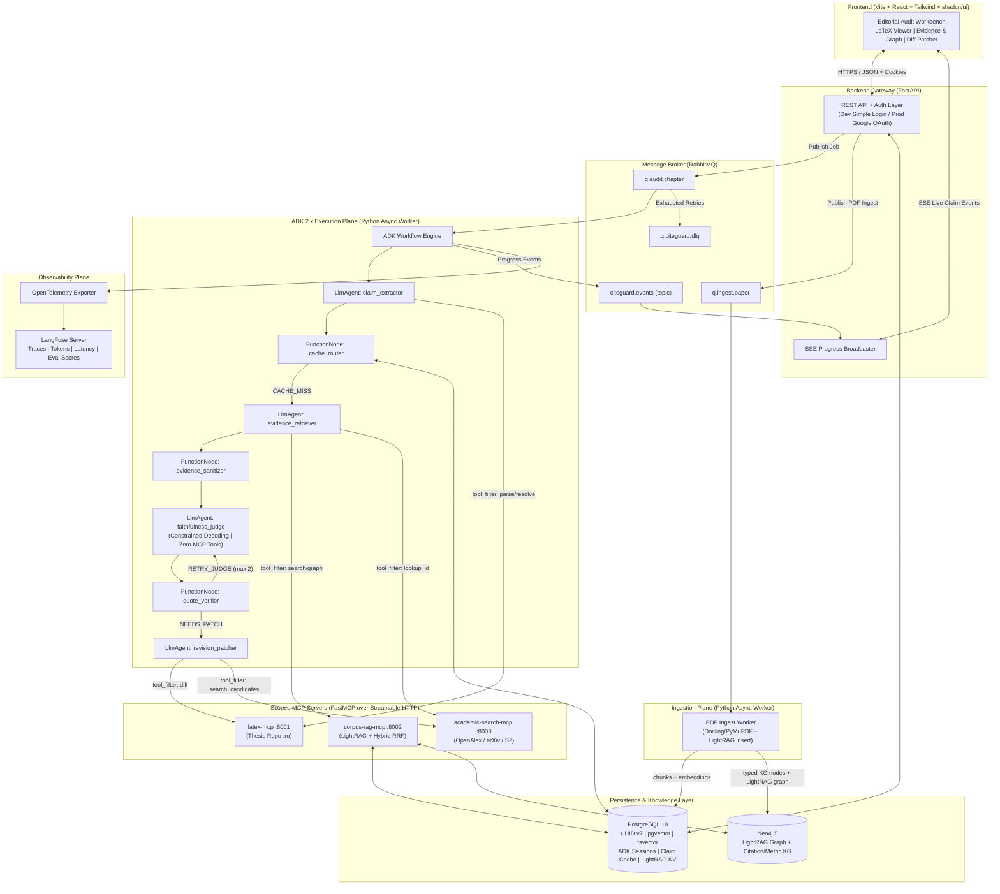
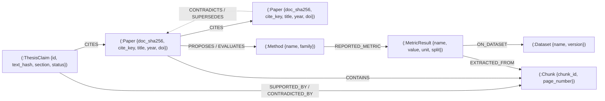
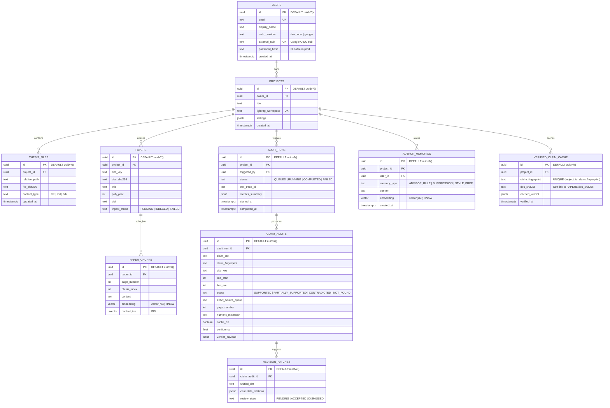

# Technical Design Document (TDD): CiteGuard — Autonomous Citation & Claim Faithfulness Auditor

| Metadata | Details |
| :--- | :--- |
| **Document Status** | Proposed — Architecture Baseline v1.1 (corrections after checking against google-adk 2.15, lightrag-hku 1.5, langfuse 5.x and fastmcp 4.x) |
| **Reference Standard** | Adapted from Google ADK Technical Design Document Reference Architecture |
| **Primary Stack** | Google ADK 2.x, FastMCP (Streamable HTTP), FastAPI, PostgreSQL 18 (`pgvector`, native `uuidv7()`), SQLAlchemy 2.0 (Async), Alembic, RabbitMQ, Neo4j + LightRAG, Vite + React + Tailwind CSS + shadcn/ui, OpenTelemetry + LangFuse, Docker Compose |
| **Core Objective** | Design, implement, evaluate, and benchmark a production-ready Multi-Agent System that audits Master's thesis drafts (`.tex` / `.md`) against cited literature for factual faithfulness, numeric drift, and citation accuracy. |

---

## 1. Executive Summary & Requirement Traceability

**CiteGuard** automates sentence-level verification of academic manuscripts against a local bibliography and external scholarly indexes. Instead of treating citation checking as a single monolithic prompt, CiteGuard separates deterministic orchestration, retrieval, adversarial sanitization, constrained entailment judging, and patch synthesis across bounded agents and isolated MCP servers.

### Goals & Non-Goals
* **Goals:** High-precision detection of unsupported claims, numeric mismatches, and citation-key swaps; cross-paper contradiction discovery via Neo4j + LightRAG; sub-second re-audits of unchanged claims via long-term claim hashing; full OpenTelemetry trace visibility into cost, latency, and grounding accuracy; reproducible ablation benchmarking.
* **Non-Goals:** Autonomous direct mutation of a thesis Git repository (CiteGuard generates reviewable unified `.patch` diffs only); full LaTeX PDF compilation/rendering inside the backend.

### Mandatory Course Requirement Traceability

| Requirement | CiteGuard Implementation | Verification Artifact |
| :--- | :--- | :--- |
| **1. Multi-Agent Architecture (at least 3 agents)** | 4 specialized Google ADK `LlmAgent`s (`claim_extractor`, `evidence_retriever`, `faithfulness_judge`, `revision_patcher`) orchestrated with deterministic `FunctionNode` routers (`cache_router`, `evidence_sanitizer`, `quote_verifier`, `cache_writer`). | ADK 2.x `Workflow` graph + role-scoped `tool_filter` configs. |
| **2. Tool Integration (at least 3 tools + Constrained Decoding)** | 3 isolated FastMCP Streamable HTTP servers (`latex-mcp`, `corpus-rag-mcp` with LightRAG + Neo4j + `pgvector`, `academic-search-mcp`) plus strict Pydantic constrained decoding on `ClaimVerificationVerdict` and `record_audit_verdict`. | MCP tool schemas + zero-parse-failure ablation benchmark. |
| **3. Hybrid Agent Memory** | **Short-Term:** ADK `DatabaseSessionService` (PostgreSQL 18 JSONB) + ephemeral `temp:*` turn state + sliding-window revision reducer. **Long-Term:** Custom `CiteGuardMemoryService` (`BaseMemoryService`) over PostgreSQL 18 (`pgvector` + `verified_claim_cache`) and Neo4j + LightRAG knowledge graph. | Cold-run vs. warm-run re-audit latency and token savings report. |
| **4. Security & Observability Pipeline** | `openinference-instrumentation-google-adk` exporting OpenTelemetry spans to LangFuse; PDF prompt-injection sanitization; zero-tool isolation for `faithfulness_judge`; read-only thesis mounts; dev/prod auth boundary. | LangFuse trace waterfall + synthetic injection resistance test suite. |

---

## 2. System Architecture & Component Topology

CiteGuard decouples interactive web requests from long-running multi-agent audit pipelines using **RabbitMQ**. The FastAPI backend serves REST endpoints and Server-Sent Events (SSE) progress streams, while horizontally scalable ADK Worker containers consume jobs, execute the ADK 2.x graph, invoke scoped FastMCP servers, and push telemetry to LangFuse.



---

## 3. Multi-Agent Orchestration (Google ADK 2.x)

### 3.1 Workflow Graph & Conditional Routing

CiteGuard uses Google ADK 2.x's typed `Workflow` graph to combine low-latency deterministic nodes (`FunctionNode`) with bounded LLM specialists (`LlmAgent`). Every claim extracted from a chapter is processed as an isolated unit of work, enabling parallel fan-out while preserving strict state isolation.

Orchestration has two levels. The audit worker first runs `claim_extractor` once per chapter to produce an `ExtractedClaimBatch`, then starts one instance of the per-claim workflow below for each claim (bounded by `max_concurrency`). `claim_extractor` is therefore not a node of the per-claim graph.

```python
from google.adk.workflow import Workflow  # singular: google.adk.workflow

citeguard_claim_workflow = Workflow(
    name="citeguard_claim_pipeline",
    edges=[
        ("START", cache_router_node),
        (
            cache_router_node,
            {
                "CACHE_HIT": result_emitter_node,
                "CACHE_MISS": evidence_retriever_agent,
            },
        ),
        (
            evidence_retriever_agent,
            evidence_sanitizer_node,
            faithfulness_judge_agent,
            quote_verifier_node,
        ),
        (
            quote_verifier_node,
            {
                "RETRY_JUDGE": faithfulness_judge_agent,  # Max 2 retries via session counter
                "VERIFIED_OK": cache_writer_node,
                "NEEDS_PATCH": revision_patcher_agent,
                "UNGROUNDED": result_emitter_node,  # Retries exhausted: emit for manual review, never cache
            },
        ),
        (revision_patcher_agent, cache_writer_node),
        (cache_writer_node, result_emitter_node),
    ],
)
```

Notes on ADK graph semantics that this design relies on:
* A plain node fires whenever **any** predecessor triggers it; only a `JoinNode` waits for all predecessors. `faithfulness_judge_agent`, `cache_writer_node` and `result_emitter_node` each have several incoming edges and must stay plain nodes, otherwise the `CACHE_HIT` and retry paths would never complete.
* **Retry exhaustion.** If the judge still returns a quote that cannot be found after 2 retries, `quote_verifier` emits `UNGROUNDED`. The claim is reported with status `NOT_FOUND`, `confidence = 0.0` and a `verdict_payload.ungrounded = true` flag so the UI can mark it for manual review. It bypasses `cache_writer`, so an unverifiable verdict is never served from cache, and bypasses `revision_patcher`, so no patch is generated from ungrounded reasoning.

### 3.2 Agent Roster & Tool Boundaries

| Agent / Node | Primitive | Model Tier | Allowed Tools (`tool_filter`) | Input / Output Contract |
| :--- | :--- | :--- | :--- | :--- |
| **`claim_extractor`** | `LlmAgent` | `gemini-2.5-flash` | `latex-mcp`: `parse_latex_section`, `resolve_bibtex_key` | In: Chapter file path + section filter. Out: `ExtractedClaimBatch` (structured JSON). |
| **`cache_router`** | `FunctionNode` | None (Deterministic) | Direct async SQLAlchemy lookup | Computes `claim_fingerprint = sha256(norm_claim \|\| cite_key \|\| doc_sha256)`. Emits `CACHE_HIT` or `CACHE_MISS`. |
| **`evidence_retriever`** | `LlmAgent` | `gemini-2.5-flash` | `corpus-rag-mcp`: `search_paper_chunks`, `query_lightrag_graph`, `get_page_window`, `get_paper_index_status`; `academic-search-mcp`: `lookup_paper_by_identifier` | Retrieves both exact passage chunks (BM25 + dense RRF) and Neo4j graph provenance (cross-paper metric/contradiction links). |
| **`evidence_sanitizer`** | `FunctionNode` | None (Deterministic) | Local sanitizer | Removes invisible Unicode, prompt-injection directives, and wraps each chunk in XML data tags (`<untrusted_evidence>`). |
| **`faithfulness_judge`** | `LlmAgent` | `gemini-2.5-pro` | **Zero external/MCP tools.** Local constrained tool `record_audit_verdict` only. | Evaluates strict entailment against sanitized evidence. Enforces `ClaimVerificationVerdict` via constrained decoding. |
| **`quote_verifier`** | `FunctionNode` | None (Deterministic) | Normalized fuzzy/exact substring verifier | Confirms `exact_source_quote` exists verbatim in retrieved chunks. Routes `RETRY_JUDGE` (max 2) if hallucinated and `UNGROUNDED` once retries are exhausted, else `VERIFIED_OK` or `NEEDS_PATCH`. |
| **`revision_patcher`** | `LlmAgent` | `gemini-2.5-pro` | `latex-mcp`: `generate_latex_diff`; `academic-search-mcp`: `search_candidate_citations` | Invoked only for `CONTRADICTED`, `PARTIALLY_SUPPORTED`, or `NOT_FOUND`. Produces minimal unified `.patch` diffs and alternative citation recommendations. |

### 3.3 Constrained Decoding Schemas

To satisfy the mandatory constrained-decoding requirement, both `faithfulness_judge` (`output_schema`) and the critical persistence tool `record_audit_verdict` enforce strict Pydantic schemas compiled to JSON Schema grammars by the model provider.

Constrained decoding guarantees the JSON shape only. The cross-field rule in `validate_grounding` below is not expressible in the grammar, so it runs after decoding; a validation failure is treated like a failed quote check and counts against the same 2-retry budget.

```python
from enum import Enum
from pydantic import BaseModel, Field, model_validator


class EntailmentStatus(str, Enum):
    SUPPORTED = "SUPPORTED"
    PARTIALLY_SUPPORTED = "PARTIALLY_SUPPORTED"
    CONTRADICTED = "CONTRADICTED"
    NOT_FOUND = "NOT_FOUND"


class EvidenceCitation(BaseModel):
    doc_sha256: str = Field(..., min_length=64, max_length=64)
    cite_key: str = Field(..., min_length=1, max_length=128)
    page_number: int = Field(..., ge=1)
    chunk_id: str = Field(..., description="UUID v7 of the matched chunk")


class ClaimVerificationVerdict(BaseModel):
    claim_id: str = Field(..., description="UUID v7 of the thesis claim")
    cite_key: str = Field(..., description="Primary BibTeX key audited")
    status: EntailmentStatus
    exact_source_quote: str | None = Field(
        default=None,
        max_length=1200,
        description="Verbatim excerpt copied from <untrusted_evidence>; required unless NOT_FOUND",
    )
    evidence_ref: EvidenceCitation | None = None
    numeric_mismatch: str | None = Field(
        default=None,
        description="Exact delta when figures disagree, e.g. 'thesis=94.2% vs paper=91.8%'",
    )
    graph_conflict_detected: bool = Field(
        default=False,
        description="True if Neo4j/LightRAG surfaced a newer paper contradicting this claim",
    )
    reasoning: str = Field(..., min_length=10, max_length=700)
    confidence: float = Field(..., ge=0.0, le=1.0)

    @model_validator(mode="after")
    def validate_grounding(self) -> "ClaimVerificationVerdict":
        if self.status != EntailmentStatus.NOT_FOUND:
            if not self.exact_source_quote or self.evidence_ref is None:
                raise ValueError(
                    "exact_source_quote and evidence_ref are required unless status is NOT_FOUND"
                )
        return self
```

---

## 4. MCP Tool Layer (3 Scoped Streamable HTTP Servers)

All external capabilities are hosted as standalone **FastMCP** microservices communicating over **Streamable HTTP** (`/mcp`), authenticated with internal service bearer tokens (`Authorization: Bearer <token>`, one distinct token per server). In production, ADK `McpToolset` instances are initialized synchronously at module scope with explicit `tool_filter` lists to enforce least privilege.

### 4.1 `latex-mcp` (`http://latex-mcp:8001/mcp`)
* **Isolation:** Project thesis files are bind-mounted **read-only** (`/data/projects:ro`). Every `file_path` / `bib_path` argument is resolved against `/data/projects/{project_id}` and rejected if the resolved path escapes that directory (`..`, absolute paths, symlinks), since these arguments are produced by an LLM.
* **Exposed Tools:**
  * `parse_latex_section(project_id: str, file_path: str, section_heading: str | None) -> list[RawSegment]` — Strips comments and non-semantic styling macros while tracking exact line numbers and `\cite`, `\citep`, `\citet` keys.
  * `resolve_bibtex_key(project_id: str, bib_path: str, cite_key: str) -> BibEntry` — Parses `.bib` entries and resolves normalized title, authors, year, DOI, arXiv ID, and local PDF checksum.
  * `generate_latex_diff(project_id: str, file_path: str, line_start: int, line_end: int, replacement: str) -> UnifiedDiff` — Returns a reviewable unified diff string without writing to disk.

### 4.2 `corpus-rag-mcp` (`http://corpus-rag-mcp:8002/mcp`)
* **Backing Stores:** PostgreSQL 18 (`pgvector` HNSW + `tsvector` GIN) + Neo4j 5 via **LightRAG**.
* **Exposed Tools:**
  * `search_paper_chunks(project_id: str, cite_key: str, query: str, top_k: int = 6) -> list[ChunkHit]` — Executes Reciprocal Rank Fusion (RRF) combining BM25 lexical matching (critical for exact metrics, hyperparameters, and p-values) with dense embeddings.
  * `query_lightrag_graph(project_id: str, query: str, mode: Literal["local", "global", "hybrid"] = "hybrid") -> GraphContext` — Queries LightRAG over Neo4j to trace multi-hop relationships (e.g., whether Paper B's claim actually cites Paper A's original number, or if a newer paper refutes a baseline).
  * `get_page_window(project_id: str, doc_sha256: str, page_number: int, radius: int = 1) -> list[PageText]` — Fetches adjacent pages when claims span tables or page breaks. Scoped by `project_id` like every other corpus tool, so a document hash alone cannot read another project's paper.
  * `get_paper_index_status(project_id: str, cite_key: str) -> IndexStatus` — Reports local ingestion status (`INDEXED | PROCESSING | MISSING`).

### 4.3 `academic-search-mcp` (`http://academic-search-mcp:8003/mcp`)
* **Backing APIs:** OpenAlex, Semantic Scholar, and arXiv with token-bucket rate limiting and PostgreSQL/in-memory response caching.
* **Exposed Tools:**
  * `lookup_paper_by_identifier(identifier: str) -> ExternalPaperRecord` — Fetches authoritative abstract, open-access PDF URL, and citation metadata when a local PDF is missing.
  * `search_candidate_citations(claim_text: str, year_min: int | None = None, limit: int = 5) -> list[CandidateCitation]` — Restricted to `revision_patcher` for proposing stronger or primary citations.

---

## 5. Knowledge Graph & Dual-Level Retrieval (Neo4j + LightRAG)

Standard vector RAG retrieves isolated text chunks, which fails on two frequent Master's thesis pitfalls: **secondary citation drift** (citing Paper B for a result that originated in Paper A and was distorted along the way) and **cross-paper metric contradictions** (two cited papers reporting conflicting numbers on the same benchmark). Pairing **LightRAG** with **Neo4j** solves both.

### 5.1 Unified LightRAG Storage Configuration

LightRAG's pluggable storage layer binds directly to CiteGuard's existing PostgreSQL 18 and Neo4j containers—avoiding redundant vector stores:

```python
from lightrag import LightRAG

rag = LightRAG(
    working_dir="/var/lib/citeguard/lightrag",
    kv_storage="PGKVStorage",
    vector_storage="PGVectorStorage",
    graph_storage="Neo4JStorage",
    doc_status_storage="PGDocStatusStorage",
    workspace=project_id,  # Strict tenant/project isolation per thesis
    embedding_func=gemini_embedding_func,  # Required: EmbeddingFunc, 768 dimensions
    llm_model_func=gemini_flash_complete,  # Required: used for entity/relation extraction
)
await rag.initialize_storages()  # Must be awaited before the first insert or query
```

LightRAG does not take connection settings as constructor arguments. The PostgreSQL and Neo4j backends read them from environment variables, which every container that instantiates LightRAG (`corpus-rag-mcp` and the ingest worker) must set: `POSTGRES_HOST`, `POSTGRES_PORT`, `POSTGRES_USER`, `POSTGRES_PASSWORD`, `POSTGRES_DATABASE`, and `NEO4J_URI`, `NEO4J_USERNAME`, `NEO4J_PASSWORD`. Note the name is `NEO4J_USERNAME`, not `NEO4J_USER`.

### 5.2 Domain Knowledge Graph Schema (Neo4j)

Alongside LightRAG's automatically extracted entity-relation graph, the PDF ingestion pipeline writes typed bibliographic and empirical nodes into Neo4j so both agents and the frontend graph explorer can execute deterministic Cypher queries:



### 5.3 Dual-Level Retrieval Workflow in `evidence_retriever`
1. **Local Mode (Precision Verification):** Combines `search_paper_chunks` (RRF over `pgvector` + `tsvector`) with LightRAG `local` mode anchored on the cited paper's entities (`Method`, `Dataset`, `MetricResult`) to extract exact passages and tables.
2. **Global / Hybrid Mode (Lineage & Contradiction Check):** When `evidence_retriever` detects a secondary citation phrase (e.g., *"as shown by Smith et al."*) or a comparative benchmark claim, it invokes `query_lightrag_graph(mode="hybrid")` to surface upstream primary sources and conflicting numbers across the entire thesis bibliography.

---

## 6. Data Model & Hybrid Agent Memory (PostgreSQL 18 + SQLAlchemy + Alembic)

PostgreSQL 18 serves as the single relational, vector, and session backbone, leveraging PostgreSQL 18's native **`uuidv7()`** function for monotonically increasing, index-friendly primary keys across every table.

### 6.1 Entity-Relationship Diagram



### 6.2 SQLAlchemy 2.0 Async Base & UUID v7 Mixin

Both PostgreSQL 18 (`server_default=text("uuidv7()")`) and Python (`uuid_utils.uuid7()`) produce RFC 9562 UUID v7 values so application code can pre-generate traceable IDs before flush while preserving database-level defaults for direct SQL inserts.

```python
import uuid
from datetime import datetime
from sqlalchemy import DateTime, MetaData, func, text
from sqlalchemy.dialects.postgresql import UUID as PG_UUID
from sqlalchemy.orm import DeclarativeBase, Mapped, mapped_column
import uuid_utils


def generate_uuidv7() -> uuid.UUID:
    return uuid.UUID(bytes=uuid_utils.uuid7().bytes)


class Base(DeclarativeBase):
    metadata = MetaData(
        naming_convention={
            "ix": "ix_%(column_0_label)s",
            "uq": "uq_%(table_name)s_%(column_0_name)s",
            "ck": "ck_%(table_name)s_%(constraint_name)s",
            "fk": "fk_%(table_name)s_%(column_0_name)s_%(referred_table_name)s",
            "pk": "pk_%(table_name)s",
        }
    )


class UUIDv7TimestampMixin:
    id: Mapped[uuid.UUID] = mapped_column(
        PG_UUID(as_uuid=True),
        primary_key=True,
        default=generate_uuidv7,
        server_default=text("uuidv7()"),
    )
    created_at: Mapped[datetime] = mapped_column(
        DateTime(timezone=True),
        server_default=func.now(),
        nullable=False,
    )
```

### 6.3 Alembic Migration Strategy
* **Async Environment:** `alembic/env.py` uses `async_engine_from_config` with `postgresql+asyncpg://`.
* **Bootstrap Migration (`0001_init_extensions.py`):** Enables `CREATE EXTENSION IF NOT EXISTS vector;` and verifies PostgreSQL 18 `uuidv7()` availability.
* **Index Definitions:** Creates `HNSW` cosine-similarity indexes (`vector_cosine_ops`) on `paper_chunks.embedding` and `author_memories.embedding`, a `GIN` index on the generated column `paper_chunks.content_tsv`, and a unique composite index on `verified_claim_cache(project_id, claim_fingerprint)`.
* **Schema Separation:** Application tables live in the `public` schema, ADK `DatabaseSessionService` tables in `adk_sessions`, and LightRAG KV/vector tables in `lightrag`, preventing Alembic autogenerate drift. Neither library has a schema option, so separation is done through the connection `search_path`: `DatabaseSessionService(db_url, connect_args={"server_settings": {"search_path": "adk_sessions"}})` (extra keyword arguments are passed to `create_async_engine`), and LightRAG connects as a dedicated PostgreSQL role whose default path is set once with `ALTER ROLE citeguard_lightrag SET search_path = lightrag, public` (`public` stays on the path so the `vector` type resolves). The bootstrap migration creates both schemas and that role, and `alembic/env.py` sets `include_schemas=False` so autogenerate only inspects `public`.
* **Embedding Model:** All `vector(768)` columns and LightRAG's `embedding_func` use the same model, `gemini-embedding-001` with `output_dimensionality=768`. Changing the model or dimension requires re-embedding the corpus and a migration, and counts as a breaking change.

### 6.4 Hybrid Agent Memory Architecture
* **Short-Term Memory (Session & Turn State):**
  * Managed by ADK's `DatabaseSessionService(db_url=settings.ADK_SESSION_DB_URL)` backed by PostgreSQL 18 JSONB tables.
  * Ephemeral retrieval chunks are stored under `temp:sanitized_chunks` and cleared after `quote_verifier` completes, preventing context window explosion.
  * Multi-turn interactive discussions in the Patch Workbench use a sliding-window reducer keeping the last 6 verbatim turns plus a rolling summary in session state.
* **Long-Term Memory (Cross-Session Persistence):**
  * Implemented via `CiteGuardMemoryService(BaseMemoryService)` querying `author_memories` (`pgvector`) for advisor rules and false-positive suppressions, `verified_claim_cache` for $O(1)$ deterministic re-audit skipping, and Neo4j + LightRAG for persistent paper and claim lineage across thesis chapters.

---

## 7. Backend API & Asynchronous Messaging (FastAPI + RabbitMQ)

### 7.1 FastAPI Service Layer

FastAPI exposes versioned JSON endpoints under `/api/v1` and a live SSE stream for audit progress. All request/response models use Pydantic v2 with strict UUID v7 validation.

| Method & Path | Purpose | Auth |
| :--- | :--- | :--- |
| `GET /api/v1/auth/config` | Returns active auth mode (`dev` or `prod`) and Google client metadata so the frontend renders the appropriate login UI. | Public |
| `POST /api/v1/auth/dev/login` | Enabled **only** when `AUTH_MODE=dev`. Validates simple email/password or dev test user and sets HTTP-only JWT cookie. | Public (Dev only) |
| `GET /api/v1/auth/google/login` & `/callback` | Enabled when `AUTH_MODE=prod`. Runs OAuth 2.0 Authorization Code + PKCE flow, verifies Google ID token, upserts user, and sets HTTP-only cookie. | Public (Prod only) |
| `POST /api/v1/auth/dev/register` | Enabled **only** when `AUTH_MODE=dev`. Creates a local email/password user. | Public (Dev only) |
| `POST /api/v1/auth/refresh` | Exchanges a valid refresh-token cookie for a new 15-minute access token (rotating the refresh token). | Refresh cookie |
| `POST /api/v1/auth/logout` | Revokes the refresh token and clears both cookies. | Authenticated |
| `POST /api/v1/projects` | Creates a thesis project and provisions its isolated LightRAG/Neo4j workspace. | Authenticated |
| `POST /api/v1/projects/{id}/papers` | Uploads reference PDF + `.bib` metadata, stores blob, publishes `ingest.paper.requested` to RabbitMQ. | Owner |
| `POST /api/v1/projects/{id}/audits` | Uploads/selects `.tex`/`.md` section, creates `audit_runs` row (UUID v7), publishes `audit.chapter.requested` to RabbitMQ, returns `202 Accepted`. | Owner |
| `GET /api/v1/audits/{run_id}/stream` | Server-Sent Events (SSE) stream relaying real-time per-claim verdicts, cache hits, and LangFuse trace URLs from RabbitMQ. | Owner |
| `GET /api/v1/audits/{run_id}/report` | Returns full claim audit results, unified LaTeX patches, and linked Neo4j subgraph JSON. | Owner |
| `PATCH /api/v1/patches/{patch_id}` | Marks a suggested revision patch `ACCEPTED` or `DISMISSED` and optionally writes a suppression rule into `author_memories`. | Owner |

### 7.2 RabbitMQ Topology & Worker Guarantees

Using `aio-pika` (or `FastStream` with RabbitMQ broker), messaging follows an explicit exchange-and-DLQ topology:

| Exchange / Queue | Type | Routing Key | Purpose & Durability |
| :--- | :--- | :--- | :--- |
| `citeguard.commands` | `direct` (durable) | `audit.chapter.requested` | Routes to `q.audit.chapter` (prefetch=2, manual `ack`, dead-lettered to `citeguard.dlx` after 3 retries). |
| `citeguard.commands` | `direct` (durable) | `ingest.paper.requested` | Routes to `q.ingest.paper` (prefetch=4), consumed by the dedicated `ingest-worker` service, which parses the PDF via Docling/PyMuPDF and writes `paper_chunks` (`pgvector`) and LightRAG/Neo4j directly. `corpus-rag-mcp` is read-only and exposes no ingestion tool. |
| `citeguard.events` | `topic` (durable) | `audit.{run_id}.progress` | Fan-out progress updates (`CLAIM_EXTRACTED`, `CACHE_HIT`, `VERDICT_READY`, `PATCH_READY`, `RUN_COMPLETED`) consumed by FastAPI SSE endpoints. |
| `citeguard.dlx` | `direct` (durable) | `dlq` | Both command queues are declared as **quorum queues** with `x-delivery-limit: 3` and `x-dead-letter-exchange: citeguard.dlx`, which is what enforces "3 retries" (classic queues do not count redeliveries). Captures poison messages in `q.citeguard.dlq` and marks the corresponding `audit_runs` row `FAILED` with error diagnostics. |

---

## 8. Authentication & Authorization Architecture

Authentication uses a clean **Strategy Pattern** controlled by `AUTH_MODE` (`dev` vs. `prod`). Regardless of mode, successful authentication issues an identical internal signed JWT (`access_token`, 15 min TTL) and refresh token stored in `HttpOnly`, `SameSite=Lax` cookies (`Secure=True` in production).

### Mode Comparison

| Aspect | Development (`AUTH_MODE=dev`) | Production (`AUTH_MODE=prod`) |
| :--- | :--- | :--- |
| **Login Mechanism** | Simple email + password form (Argon2id hashed in PostgreSQL) + optional seeded demo account (`researcher@citeguard.local`). | Google OAuth 2.0 / OIDC (Authorization Code Flow with PKCE + signed `state` & `nonce` cookies via `Authlib`). |
| **Route Registration** | `/auth/dev/login` and `/auth/dev/register` registered; Google OAuth routes disabled. | `/auth/google/login` and `/auth/google/callback` registered; dev login routes return `404` (never mounted in FastAPI router). |
| **User Provisioning** | Local seed script or dev signup endpoint. | Just-In-Time (JIT) provisioning keyed on verified Google `sub` claim (`email_verified == true` enforced). |
| **Production Safety Gate** | App startup asserts `ENVIRONMENT != "production"` if `AUTH_MODE == "dev"` (fail-closed startup check). | Requires `GOOGLE_CLIENT_ID`, `GOOGLE_CLIENT_SECRET`, `GOOGLE_REDIRECT_URI`, and 256-bit `JWT_SECRET_KEY`. |

Authorization is enforced on every FastAPI dependency (`require_project_owner`) so users can only access thesis files, Neo4j workspaces, and audit traces belonging to projects they own.

---

## 9. Frontend Architecture & UI/UX Design

### 9.1 Tech Stack
* **Core:** Vite 6, React 19, TypeScript (strict mode).
* **Styling & Primitives:** Tailwind CSS v4 + **shadcn/ui** (Radix UI primitives) + `lucide-react` icons.
* **Specialized Libraries:**
  * `@tanstack/react-query` — Server state caching and optimistic patch review actions.
  * `@codemirror/view` + `codemirror-lang-latex` — Syntax-highlighted LaTeX editor with custom inline claim decorations.
  * `react-diff-viewer-continued` — Clean side-by-side or unified LaTeX diff inspection for `revision_patcher` suggestions.
  * `react-force-graph-2d` (or `@xyflow/react`) — Interactive Neo4j/LightRAG citation-and-metric lineage graph modal/drawer.
  * `recharts` — Benchmark & telemetry dashboards (verdict distribution, cache hit rate, latency p50/p95).

### 9.2 Aesthetic Direction: "Editorial Scholarly Studio"

Rather than a generic dark-neon developer dashboard, CiteGuard adopts an **Editorial Scholarly Studio** design language optimized for long reading and writing sessions:
* **Palette:** Warm archival paper canvas (`#FAF8F5`) with crisp pure-white elevated cards (`#FFFFFF`) and subtle stone borders (`#E7E5E4`) in Light Mode; deep charcoal-slate (`#111318`) with warm off-white ink in Dark Mode.
* **Typography:** High-legibility sans-serif (`Inter` / `Geist`) for UI chrome, academic serif (`Newsreader` or `Source Serif 4`) for quoted paper passages, and `JetBrains Mono` for LaTeX source, BibTeX keys, and unified diffs.
* **Semantic Status Tokens:** Muted, accessible accents rather than harsh primaries—Emerald (`SUPPORTED`), Amber (`PARTIALLY_SUPPORTED`), Crimson/Terracotta (`CONTRADICTED`), and Slate (`NOT_FOUND`), paired with an instant "Cached" bolt badge on warm-memory hits.

### 9.3 Primary Views & Layout
1. **3-Pane Audit Workbench (Core Workspace):**
   * *Left Pane (40%):* LaTeX/Markdown thesis viewer with subtle colored wavy underlines on audited claims and line-margin status pills. Clicking any underlined claim locks focus across the other panes.
   * *Center Pane (35%):* **Evidence & Lineage Inspector** displaying the `ClaimVerificationVerdict` badge, numeric delta callout (e.g., `Thesis: 94.2%` vs. `Paper p. 7: 91.8%`), highlighted `exact_source_quote` rendered in editorial serif with page jump, and a toggleable **Neo4j Knowledge Graph** mini-view showing upstream/conflicting papers.
   * *Right Pane (25%):* **Revision Patcher & Memory Panel** showing the generated unified LaTeX diff, one-click Copy Patch / Accept / Dismiss controls, alternative citation cards, and a "Remember this exception" button writing to `author_memories`.
2. **Live Audit Telemetry Drawer (Bottom Collapsible Sheet):** Real-time SSE stream showing active agent transitions (`Extractor -> Cache Router -> Retriever -> Judge -> Quote Verifier`), token counter, cache-hit savings, and a deep link to the exact LangFuse trace.
3. **Corpus & Knowledge Graph Explorer:** Drag-and-drop PDF + `.bib` uploader with RabbitMQ ingestion progress bars and a full-canvas interactive Neo4j graph filtered by `CONTRADICTS`, `CITES`, and `REPORTED_METRIC`.
4. **Benchmark & Ablation Dashboard:** Visualizes evaluation runs (Macro-F1, schema pass rate, cold vs. warm latency) directly inside the app for live group-project demos.

---

## 10. Security, Privacy & Observability Pipeline

### 10.1 Defense-in-Depth Against Indirect Prompt Injection
Academic PDFs and external web abstracts are untrusted inputs. CiteGuard enforces four layered controls:
1. **Sanitization Gate (`evidence_sanitizer`):** Strips zero-width Unicode characters, hidden PDF text layers (zero font size or background-matched RGB during Docling/PyMuPDF extraction), and flags instruction-like strings before wrapping text in explicit `<untrusted_evidence>` delimiters.
2. **Zero-Tool Judge Isolation:** `faithfulness_judge` has no access to MCP file, RAG, or web tools—neutralizing data-exfiltration or tool-hijack payloads hidden in papers.
3. **Deterministic Quote Grounding (`quote_verifier`):** Every non-`NOT_FOUND` verdict must contain a verbatim substring verified programmatically against retrieved evidence chunks.
4. **Container & Network Hardening:** All services run as non-root UIDs; `latex-mcp` mounts thesis directories read-only; MCP servers listen only on the internal Docker bridge network and validate the `Authorization: Bearer` service token.

**Residual risk.** `evidence_retriever` is an LLM with tools that reads retrieved chunks *before* `evidence_sanitizer` runs, so it is the one agent exposed to raw paper text. Its blast radius is limited by design: all of its tools are read-only and project-scoped, and its only outbound call is `lookup_paper_by_identifier`, whose argument is validated against DOI / arXiv / OpenAlex ID patterns so it cannot carry free text to an external API. Its output reaches the judge only as chunks that pass through the sanitizer.

### 10.2 OpenTelemetry & LangFuse Instrumentation

All FastAPI requests, RabbitMQ message handoffs (propagating W3C `traceparent` headers inside AMQP message properties), ADK workflow spans, and FastMCP tool calls share one unified trace ID exported to **LangFuse**:

```python
from langfuse import get_client
from openinference.instrumentation.google_adk import GoogleADKInstrumentor
from opentelemetry.instrumentation.fastapi import FastAPIInstrumentor

langfuse = get_client()
assert langfuse.auth_check(), "LangFuse OTel configuration failed"

GoogleADKInstrumentor().instrument()
FastAPIInstrumentor.instrument_app(app)
```

**Tracked Span Attributes & LangFuse Scores:**
* **Root Trace (`citeguard.audit_chapter`):** `user_id`, `session_id`, `project_id`, `audit_run_id`, `ablation_profile`.
* **Agent & MCP Spans:** `llm.token_count.prompt`, `llm.token_count.completion`, `citeguard.cache_hit`, `citeguard.rrf_top_score`, `citeguard.lightrag_mode`, `citeguard.quote_retry_count`, `citeguard.constrained_schema`.
* **Automated Eval Scores:** `verdict_exact_match`, `quote_groundedness`, `numeric_delta_accuracy`, `warm_cache_token_savings_pct`.

---

## 11. Containerization & Deployment (`Dockerfile` & `docker-compose.yml`)

### 11.1 Repository & Service Layout

```text
citeguard/
├── backend/                  # FastAPI API + ADK 2.x Worker + Alembic migrations
│   ├── app/
│   │   ├── api/              # REST + SSE + Auth strategies (dev/prod)
│   │   ├── agents/           # ADK Workflow, LlmAgents, FunctionNodes, MemoryService
│   │   ├── db/               # SQLAlchemy 2.0 async models (UUID v7), Alembic
│   │   └── workers/          # RabbitMQ consumers: audit_worker, ingest_worker
│   └── Dockerfile
├── infra/
│   └── postgres/init/        # 01-create-langfuse-db.sql (runs on first Postgres start)
├── mcp-servers/
│   ├── latex-mcp/            # FastMCP :8001 (Streamable HTTP)
│   ├── corpus-rag-mcp/       # FastMCP :8002 (pgvector + Neo4j/LightRAG)
│   └── academic-search-mcp/  # FastMCP :8003 (OpenAlex / arXiv / S2)
├── frontend/                 # Vite + React + Tailwind + shadcn/ui
│   ├── src/
│   └── Dockerfile
├── benchmarks/               # Synthetic corruption generator & ablation runner
└── docker-compose.yml
```

### 11.2 Multi-Stage `Dockerfile` Templates

**Backend & ADK Worker (`backend/Dockerfile`):**

```dockerfile
FROM python:3.12-slim AS builder
# Same path as the runtime stage: a virtualenv is not relocatable, its
# console scripts (uvicorn, alembic) hard-code the interpreter path.
WORKDIR /app
RUN pip install --no-cache-dir uv
COPY pyproject.toml uv.lock ./
# Dependencies only; the application source is copied in the runtime stage.
RUN uv sync --frozen --no-dev --no-install-project

FROM python:3.12-slim AS runtime
RUN groupadd --gid 10001 app && useradd --uid 10001 --gid app --create-home app
WORKDIR /app
COPY --from=builder /app/.venv /app/.venv
COPY app ./app
COPY alembic ./alembic
COPY alembic.ini ./
ENV PATH="/app/.venv/bin:$PATH" PYTHONUNBUFFERED=1
USER app
EXPOSE 8000
CMD ["uvicorn", "app.main:app", "--host", "0.0.0.0", "--port", "8000"]
```

**Frontend (`frontend/Dockerfile`):**

```dockerfile
FROM node:22-alpine AS builder
WORKDIR /build
COPY package.json pnpm-lock.yaml ./
RUN corepack enable && pnpm install --frozen-lockfile
COPY . .
RUN pnpm build

FROM nginx:1.27-alpine AS runtime
COPY nginx.conf /etc/nginx/conf.d/default.conf
COPY --from=builder /build/dist /usr/share/nginx/html
EXPOSE 80
```

### 11.3 Reference `docker-compose.yml` (Development Defaults)

This file is the development and demo stack. The `:-` fallbacks are development credentials, and the Neo4j, RabbitMQ management and LangFuse ports are published to the host for debugging. A production deployment must supply every secret explicitly and remove those `ports` entries.

```yaml
name: citeguard

# Shared by langfuse (web) and langfuse-worker. LangFuse v3 needs PostgreSQL,
# ClickHouse, Redis and S3-compatible storage. Keep these in sync with the
# official LangFuse self-hosting docker-compose.yml when upgrading.
x-langfuse-env: &langfuse-env
  DATABASE_URL: postgresql://citeguard:${POSTGRES_PASSWORD:-citeguard_dev}@postgres:5432/langfuse
  NEXTAUTH_URL: http://localhost:3001
  NEXTAUTH_SECRET: ${LANGFUSE_NEXTAUTH_SECRET:-dev_nextauth_secret_change_me}
  SALT: ${LANGFUSE_SALT:-dev_salt_change_me}
  # 64 hex characters; generate with `openssl rand -hex 32`
  ENCRYPTION_KEY: ${LANGFUSE_ENCRYPTION_KEY:-0000000000000000000000000000000000000000000000000000000000000000}
  CLICKHOUSE_URL: http://clickhouse:8123
  CLICKHOUSE_MIGRATION_URL: clickhouse://clickhouse:9000
  CLICKHOUSE_USER: clickhouse
  CLICKHOUSE_PASSWORD: ${CLICKHOUSE_PASSWORD:-citeguard_ch_dev}
  CLICKHOUSE_CLUSTER_ENABLED: "false"
  REDIS_HOST: redis
  REDIS_PORT: "6379"
  REDIS_AUTH: ${REDIS_PASSWORD:-citeguard_redis_dev}
  LANGFUSE_S3_EVENT_UPLOAD_BUCKET: langfuse
  LANGFUSE_S3_EVENT_UPLOAD_REGION: auto
  LANGFUSE_S3_EVENT_UPLOAD_ACCESS_KEY_ID: ${MINIO_ROOT_USER:-minio}
  LANGFUSE_S3_EVENT_UPLOAD_SECRET_ACCESS_KEY: ${MINIO_ROOT_PASSWORD:-citeguard_minio_dev}
  LANGFUSE_S3_EVENT_UPLOAD_ENDPOINT: http://minio:9000
  LANGFUSE_S3_EVENT_UPLOAD_FORCE_PATH_STYLE: "true"

services:
  postgres:
    image: pgvector/pgvector:pg18
    environment:
      POSTGRES_DB: citeguard
      POSTGRES_USER: citeguard
      POSTGRES_PASSWORD: ${POSTGRES_PASSWORD:-citeguard_dev}
    volumes:
      - pg_data:/var/lib/postgresql
      # Creates the separate `langfuse` database on first start.
      - ./infra/postgres/init:/docker-entrypoint-initdb.d:ro
    healthcheck:
      test: ["CMD-SHELL", "pg_isready -U citeguard -d citeguard"]
      interval: 5s
      timeout: 5s
      retries: 10
    networks: [internal]

  neo4j:
    image: neo4j:5.26-community
    environment:
      NEO4J_AUTH: neo4j/${NEO4J_PASSWORD:-citeguard_neo4j_dev}
      NEO4J_PLUGINS: '["apoc"]'
      NEO4J_server_memory_heap_initial__size: 512m
      NEO4J_server_memory_heap_max__size: 1G
    ports:
      - "7474:7474"
      - "7687:7687"
    volumes:
      - neo4j_data:/data
    healthcheck:
      test: ["CMD-SHELL", "cypher-shell -u neo4j -p ${NEO4J_PASSWORD:-citeguard_neo4j_dev} 'RETURN 1'"]
      interval: 10s
      timeout: 5s
      retries: 10
    networks: [internal]

  rabbitmq:
    image: rabbitmq:4.0-management-alpine
    environment:
      RABBITMQ_DEFAULT_USER: ${RABBITMQ_USER:-citeguard}
      RABBITMQ_DEFAULT_PASS: ${RABBITMQ_PASS:-citeguard_mq_dev}
    ports:
      - "15672:15672"
    volumes:
      - rabbitmq_data:/var/lib/rabbitmq
    healthcheck:
      test: ["CMD", "rabbitmq-diagnostics", "-q", "ping"]
      interval: 10s
      timeout: 5s
      retries: 10
    networks: [internal]

  clickhouse:
    image: clickhouse/clickhouse-server:24.12
    environment:
      CLICKHOUSE_DB: default
      CLICKHOUSE_USER: clickhouse
      CLICKHOUSE_PASSWORD: ${CLICKHOUSE_PASSWORD:-citeguard_ch_dev}
    volumes:
      - clickhouse_data:/var/lib/clickhouse
    healthcheck:
      test: ["CMD-SHELL", "wget -q --spider http://localhost:8123/ping || exit 1"]
      interval: 5s
      timeout: 5s
      retries: 10
    networks: [internal]

  redis:
    image: redis:7-alpine
    command: ["redis-server", "--requirepass", "${REDIS_PASSWORD:-citeguard_redis_dev}"]
    healthcheck:
      test: ["CMD-SHELL", "redis-cli -a ${REDIS_PASSWORD:-citeguard_redis_dev} ping | grep -q PONG"]
      interval: 5s
      timeout: 5s
      retries: 10
    networks: [internal]

  minio:
    image: minio/minio
    entrypoint: sh
    command: -c 'mkdir -p /data/langfuse && minio server --address ":9000" /data'
    environment:
      MINIO_ROOT_USER: ${MINIO_ROOT_USER:-minio}
      MINIO_ROOT_PASSWORD: ${MINIO_ROOT_PASSWORD:-citeguard_minio_dev}
    volumes:
      - minio_data:/data
    networks: [internal]

  langfuse-worker:
    image: langfuse/langfuse-worker:3
    environment: *langfuse-env
    depends_on: &langfuse-depends
      postgres: { condition: service_healthy }
      clickhouse: { condition: service_healthy }
      redis: { condition: service_healthy }
      minio: { condition: service_started }
    networks: [internal]

  langfuse:
    image: langfuse/langfuse:3
    ports:
      - "3001:3000"
    environment: *langfuse-env
    depends_on: *langfuse-depends
    networks: [internal, edge]

  latex-mcp:
    build: ./mcp-servers/latex-mcp
    environment:
      MCP_SERVICE_TOKEN: ${LATEX_MCP_TOKEN:-dev_latex_token}
    volumes:
      - thesis_storage:/data/projects:ro
    networks: [internal]

  corpus-rag-mcp:
    build: ./mcp-servers/corpus-rag-mcp
    environment:
      MCP_SERVICE_TOKEN: ${CORPUS_MCP_TOKEN:-dev_corpus_token}
      DATABASE_URL: postgresql+asyncpg://citeguard:${POSTGRES_PASSWORD:-citeguard_dev}@postgres:5432/citeguard
      # LightRAG reads its connections from these variables (see section 5.1).
      POSTGRES_HOST: postgres
      POSTGRES_PORT: "5432"
      POSTGRES_USER: citeguard_lightrag
      POSTGRES_PASSWORD: ${LIGHTRAG_DB_PASSWORD:-citeguard_lightrag_dev}
      POSTGRES_DATABASE: citeguard
      NEO4J_URI: bolt://neo4j:7687
      NEO4J_USERNAME: neo4j
      NEO4J_PASSWORD: ${NEO4J_PASSWORD:-citeguard_neo4j_dev}
      GOOGLE_API_KEY: ${GOOGLE_API_KEY}
    depends_on:
      postgres: { condition: service_healthy }
      neo4j: { condition: service_healthy }
    networks: [internal]

  ingest-worker:
    build: ./backend
    command: ["python", "-m", "app.workers.ingest_worker"]
    environment:
      DATABASE_URL: postgresql+asyncpg://citeguard:${POSTGRES_PASSWORD:-citeguard_dev}@postgres:5432/citeguard
      RABBITMQ_URL: amqp://${RABBITMQ_USER:-citeguard}:${RABBITMQ_PASS:-citeguard_mq_dev}@rabbitmq:5672/
      POSTGRES_HOST: postgres
      POSTGRES_PORT: "5432"
      POSTGRES_USER: citeguard_lightrag
      POSTGRES_PASSWORD: ${LIGHTRAG_DB_PASSWORD:-citeguard_lightrag_dev}
      POSTGRES_DATABASE: citeguard
      NEO4J_URI: bolt://neo4j:7687
      NEO4J_USERNAME: neo4j
      NEO4J_PASSWORD: ${NEO4J_PASSWORD:-citeguard_neo4j_dev}
      GOOGLE_API_KEY: ${GOOGLE_API_KEY}
      LANGFUSE_HOST: http://langfuse:3000
      LANGFUSE_PUBLIC_KEY: ${LANGFUSE_PUBLIC_KEY:-}
      LANGFUSE_SECRET_KEY: ${LANGFUSE_SECRET_KEY:-}
    volumes:
      - paper_storage:/data/papers:ro
    depends_on:
      postgres: { condition: service_healthy }
      neo4j: { condition: service_healthy }
      rabbitmq: { condition: service_healthy }
    networks: [internal]

  academic-search-mcp:
    build: ./mcp-servers/academic-search-mcp
    environment:
      MCP_SERVICE_TOKEN: ${ACADEMIC_MCP_TOKEN:-dev_academic_token}
      OPENALEX_MAILTO: ${OPENALEX_MAILTO:-dev@citeguard.local}
      SEMANTIC_SCHOLAR_API_KEY: ${SEMANTIC_SCHOLAR_API_KEY:-}
    networks: [internal]

  backend-api:
    build: ./backend
    ports:
      - "8000:8000"
    environment:
      ENVIRONMENT: ${ENVIRONMENT:-development}
      AUTH_MODE: ${AUTH_MODE:-dev}
      DATABASE_URL: postgresql+asyncpg://citeguard:${POSTGRES_PASSWORD:-citeguard_dev}@postgres:5432/citeguard
      RABBITMQ_URL: amqp://${RABBITMQ_USER:-citeguard}:${RABBITMQ_PASS:-citeguard_mq_dev}@rabbitmq:5672/
      JWT_SECRET_KEY: ${JWT_SECRET_KEY:-dev_jwt_secret_replace_in_prod}
      GOOGLE_CLIENT_ID: ${GOOGLE_CLIENT_ID:-}
      GOOGLE_CLIENT_SECRET: ${GOOGLE_CLIENT_SECRET:-}
      GOOGLE_REDIRECT_URI: ${GOOGLE_REDIRECT_URI:-http://localhost:8000/api/v1/auth/google/callback}
      LANGFUSE_HOST: http://langfuse:3000
      LANGFUSE_PUBLIC_KEY: ${LANGFUSE_PUBLIC_KEY:-}
      LANGFUSE_SECRET_KEY: ${LANGFUSE_SECRET_KEY:-}
    volumes:
      - thesis_storage:/data/projects
      - paper_storage:/data/papers   # Uploaded reference PDFs, read by ingest-worker
    depends_on:
      postgres: { condition: service_healthy }
      rabbitmq: { condition: service_healthy }
    networks: [internal, edge]

  adk-worker:
    build: ./backend
    command: ["python", "-m", "app.workers.audit_worker"]
    environment:
      DATABASE_URL: postgresql+asyncpg://citeguard:${POSTGRES_PASSWORD:-citeguard_dev}@postgres:5432/citeguard
      ADK_SESSION_DB_URL: postgresql+asyncpg://citeguard:${POSTGRES_PASSWORD:-citeguard_dev}@postgres:5432/citeguard
      RABBITMQ_URL: amqp://${RABBITMQ_USER:-citeguard}:${RABBITMQ_PASS:-citeguard_mq_dev}@rabbitmq:5672/
      LATEX_MCP_URL: http://latex-mcp:8001/mcp
      CORPUS_MCP_URL: http://corpus-rag-mcp:8002/mcp
      ACADEMIC_MCP_URL: http://academic-search-mcp:8003/mcp
      LATEX_MCP_TOKEN: ${LATEX_MCP_TOKEN:-dev_latex_token}
      CORPUS_MCP_TOKEN: ${CORPUS_MCP_TOKEN:-dev_corpus_token}
      ACADEMIC_MCP_TOKEN: ${ACADEMIC_MCP_TOKEN:-dev_academic_token}
      GOOGLE_API_KEY: ${GOOGLE_API_KEY}
      LANGFUSE_HOST: http://langfuse:3000
      LANGFUSE_PUBLIC_KEY: ${LANGFUSE_PUBLIC_KEY:-}
      LANGFUSE_SECRET_KEY: ${LANGFUSE_SECRET_KEY:-}
    depends_on:
      postgres: { condition: service_healthy }
      neo4j: { condition: service_healthy }
      rabbitmq: { condition: service_healthy }
      latex-mcp: { condition: service_started }
      corpus-rag-mcp: { condition: service_started }
      academic-search-mcp: { condition: service_started }
    networks: [internal]

  frontend:
    build: ./frontend
    ports:
      - "5173:80"
    depends_on:
      - backend-api
    networks: [edge]

volumes:
  pg_data:
  neo4j_data:
  rabbitmq_data:
  clickhouse_data:
  minio_data:
  thesis_storage:
  paper_storage:

networks:
  internal:
    driver: bridge
  edge:
    driver: bridge
```

*(Note: LangFuse v3 or later is required, not optional. The OpenTelemetry (OTLP) ingestion endpoint that the current LangFuse Python SDK and `GoogleADKInstrumentor` export to does not exist in LangFuse v2, so a v2 server would receive no traces. This is why the stack includes ClickHouse, Redis and MinIO. A lighter alternative for demos is LangFuse Cloud: drop those five services and point `LANGFUSE_HOST` at the cloud endpoint.)*

---

## 12. Evaluation, Benchmarking & Ablation Strategy

To deliver rigorous empirical results for your group project evaluation, `benchmarks/run_eval.py` executes automated sweeps over a 180-claim test suite built from real open-access arXiv papers (90 unmodified ground-truth claims + 90 controlled corruptions across four failure modes: numeric drift, scope/polarity inversion, citation-key swap, and fabricated metrics) and logs every run to LangFuse under distinct tags.

### Controlled Ablation Matrix

| Ablation Axis | Variant A (Control) | Variant B (CiteGuard Full) | Primary Metrics Logged in LangFuse |
| :--- | :--- | :--- | :--- |
| **Orchestration** | Single monolithic `LlmAgent` with all tools | 4-Agent ADK `Workflow` + deterministic `quote_verifier` | Macro-F1, Verbatim Quote Groundedness %, Cost per 100 claims |
| **Constrained Decoding** | Prompt-instructed JSON only | Pydantic `output_schema` + typed `record_audit_verdict` | Schema validation pass@1 rate, JSON parse retry count |
| **Retrieval & KG** | Dense `pgvector` only | Hybrid BM25 + `pgvector` RRF + Neo4j/LightRAG dual-level | Recall@5 on numeric-drift claims, cross-paper contradiction detection rate |
| **Hybrid Memory** | Short-term session only (cold every run) | Short-term + `verified_claim_cache` (re-audit after 15% chapter edit) | End-to-end p50/p95 latency, total prompt token reduction % |
| **Security Resilience** | Unsanitized PDF chunks | `evidence_sanitizer` + zero-tool `faithfulness_judge` | Attack Success Rate (ASR) on 20 seeded indirect prompt-injection PDFs |

### Implementation Milestones (4-Week Group Sprint Plan)
1. **Week 1 — Foundation & Data Plane:** Docker Compose bring-up (PostgreSQL 18 + `pgvector`, Neo4j, RabbitMQ, LangFuse), Alembic UUID v7 migrations, pluggable Dev/Prod Auth, and `latex-mcp` + `academic-search-mcp`.
2. **Week 2 — Knowledge Graph & ADK Graph Core:** PDF ingestion worker (Docling/PyMuPDF -> `pgvector` + LightRAG/Neo4j), `corpus-rag-mcp`, ADK 2.x `Workflow` with all 4 agents, constrained decoding schemas, and `quote_verifier` loop.
3. **Week 3 — Editorial Frontend & Live Observability:** Vite + Tailwind + shadcn/ui 3-pane Audit Workbench, SSE progress wiring from RabbitMQ, Neo4j lineage graph viewer, diff reviewer, and full `GoogleADKInstrumentor` LangFuse tracing.
4. **Week 4 — Benchmarking, Security Testing & Polish:** Run the 180-claim synthetic corruption benchmark and 5-axis ablation matrix, capture LangFuse trace comparisons, verify `AUTH_MODE=prod` Google OAuth flow, and finalize the report.